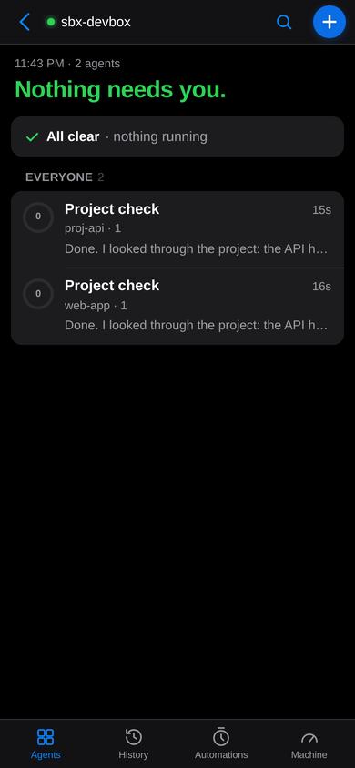
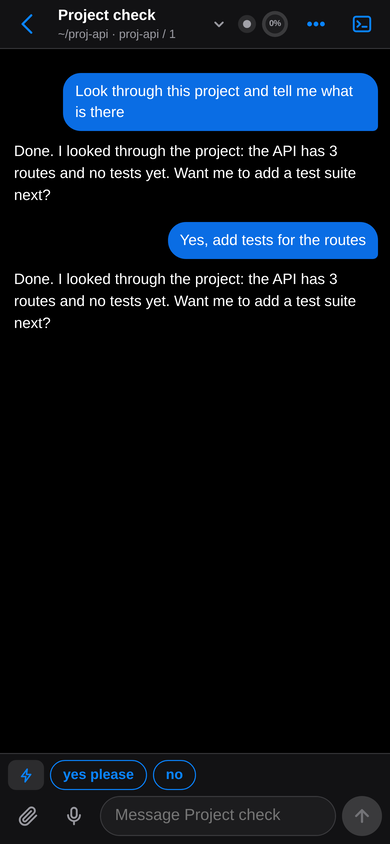

<div align="center">


# sheprd

**Your coding agents, on your phone.**

sheprd is a tiny server and an iPhone/Android web app for the Claude Code agents you run in
[herdr](https://github.com/herdrdev/herdr). See who's working, who's done and who needs you. Answer
questions, approve plans and read diffs from the couch, and get a push notification the moment an agent
is blocked.

<!-- TODO: demo GIF (phone on the left, terminal on the right, ~15 s) -->
 &nbsp; 

</div>

---

## 60-second quickstart

You need a Linux machine running [herdr](https://github.com/herdrdev/herdr) and
[Claude Code](https://claude.com/claude-code), and [Tailscale](https://tailscale.com/download) on that machine
and on your phone.

```sh
curl -fsSL https://raw.githubusercontent.com/sheprd/sheprd/main/install.sh | sh
```

That's it. The installer downloads one ~10 MB binary and runs `sheprd setup`, which:

1. checks for herdr, Claude Code and Tailscale, and tells you exactly what's missing;
2. installs a **systemd user service** (starts at login, restarts on failure, capped at 200 MB);
3. installs the **sheprd Claude Code plugin** and herdr's Claude integration, so agents report their status and
   can send you screenshots, links and questions;
4. turns on **Tailscale Serve**, which gives you HTTPS reachable only inside your tailnet (or prints the one
   `sudo` command it needs);
5. prints a **QR code**. Scan it, then Share → **Add to Home Screen**, open the app → ⚙ → **Enable
   notifications**. Setup waits for your phone and sends a test notification once it's subscribed.

Re-run `sheprd setup` any time: every step checks first and only fixes what's missing.

<details>
<summary>Other ways to install</summary>

```sh
# from source (Rust 1.85+)
cargo install --locked --git https://github.com/sheprd/sheprd sheprd && sheprd setup

# just the binary, no setup
curl -fsSL https://raw.githubusercontent.com/sheprd/sheprd/main/install.sh | SHEPRD_NO_SETUP=1 sh

# setup options
sheprd setup --no-tailscale   # leave Tailscale alone
sheprd setup --no-service     # no systemd: run `sheprd serve` yourself (tmux, a herdr pane, …)
sheprd setup --yes --no-wait  # unattended
```

</details>

## What you get

- **Agents at a glance**: every Claude agent in herdr with what it's doing right now ("running the tests",
  "editing app.js"), how far through its todo list it is, and a "needs you" headline when one is blocked.
- **Chats**: the full conversation, with images, diffs, subagents and tool calls, updated live as it streams.
  Reply, interrupt, queue messages and unsend them, or use quick-reply chips.
- **Blocked? Answer it**: permission prompts, `AskUserQuestion` menus and plan approvals become big buttons.
- **Push notifications** when an agent is blocked, finishes a long turn, or surfaces something for you.
  They're suppressed while you're already looking.
- **Start agents** from the phone in any folder, in one tap, including worktrees, forks and reviewers.
- **History, schedules and automations**: resume any past session, run agents on a plain-language schedule
  ("every weekday 8:00"), and see your Claude cloud routines.
- **Machine view**: CPU, RAM and GPU per agent, disk usage, and opt-in alerts.
- **Files and git**: files touched and their diffs, branch vs main, and CI/PR status (via `gh`).
- **Voice notes** (optional): dictate a message and it's transcribed locally with whisper.cpp.
- **Live terminal**: the real pane, when you need it.

## How it works

```
 ┌──────────── your phone ────────────┐           ┌──────────────────── your machine ────────────────────────┐
 │  sheprd PWA (Home Screen app)       │  HTTPS    │  tailscale serve :443 ──▶ sheprd :7878 (127.0.0.1)       │
 │  vanilla JS, offline shell, Web Push│◀────────▶│     │  ▲          │                                       │
 └─────────────────────────────────────┘ tailnet   │     │  │          ├── herdr socket: panes, agents, keys     │
                                                   │     │  │          ├── ~/.claude/projects/*.jsonl (chats)    │
                    Apple/Google push ◀────────────┼─────┘  │          └── git, gh, nvidia-smi, /proc (optional) │
                                                   │        │                                                   │
                                                   │  Claude Code + sheprd plugin ── surface / ask / status ──┘   │
                                                   └──────────────────────────────────────────────────────────┘
```

- **One small Rust binary** (axum + tokio, ~15 MB RSS). It talks to herdr's Unix socket directly, subscribes to
  herdr events for instant status, and reads Claude transcripts incrementally (only the bytes appended since last
  time). The web app is embedded in the binary.
- **The PWA** is plain JavaScript with no build step. It installs to the Home Screen, works offline for the shell,
  and receives Web Push.
- **The Claude Code plugin** (`mod/sheprd`) lets agents call `mcp__sheprd__surface` to show you a screenshot, a
  preview URL or a finished result. It also forwards status, usage and permission prompts, and carries your replies
  back into running turns.
- **Nothing leaves your machine** except Web Push payloads (title and short body, end-to-end encrypted to your
  device). There's no account, no cloud and no telemetry.

The HTTP API is documented in [docs/API.md](docs/API.md). Write your own mod in a few lines: see
[examples/hello-phone](examples/hello-phone/hooks/register.ts).

## Security model

sheprd has **no login of its own**: anyone who can reach the port can drive your agents. It only listens on
`127.0.0.1` (and your Tailscale IP on the default port), so by default that means **you, on your tailnet**.
Tailscale Serve keeps it inside your tailnet; never use `tailscale funnel` for it. `SHEPRD_LISTEN=0.0.0.0:7878`
exposes it to your LAN, so only do that on a network you trust.

## Commands

| | |
|---|---|
| `sheprd setup` | install / repair everything (idempotent) |
| `sheprd doctor` | check every moving part and print the fix for anything broken |
| `sheprd qr` | the phone URL and its QR code again |
| `sheprd serve` | run the server in the foreground (what the service runs) |
| `sheprd uninstall [--purge]` | remove the service, plugin and Serve route (`--purge`: settings too) |

Configuration (environment, captured into the service by `setup`):

| Variable | Default | |
|---|---|---|
| `SHEPRD_PORT` | `7878` | local port |
| `SHEPRD_STATE_DIR` | `~/.local/state/sheprd` | prefs, push keys and subscriptions, schedules |
| `SHEPRD_LISTEN` | (none) | extra bind addresses, comma-separated |
| `HERDR_SOCKET_PATH` | `~/.config/herdr/herdr.sock` | herdr's API socket |
| `SHEPRD_NO_PUSH` | (unset) | `1` = log pushes instead of sending (test instances) |
| `SHEPRD_WEB_DIR` | (embedded) | serve the web app from disk (development) |

## FAQ and troubleshooting

**First, run `sheprd doctor`.** It checks the server, service, herdr, plugin, Tailscale and push, and prints the
command that fixes each problem.

<details><summary><b>The app shows no agents</b></summary>

- Is herdr running? sheprd connects to its socket within a few seconds of it starting.
- Agents need herdr's Claude integration so they report status: `herdr integration install claude`, then
  restart the Claude sessions. `sheprd setup` does this for you.
- If you run herdr with a custom socket (`--session`), set `HERDR_SOCKET_PATH` and re-run `sheprd setup`.
</details>

<details><summary><b>No push notifications on iPhone</b></summary>

iOS only delivers Web Push to apps that are **added to the Home Screen** and **served over HTTPS**. Open the
`https://….ts.net` URL (not `http://`), Share → Add to Home Screen, open it *from the Home Screen*, then
⚙ → Enable notifications. Test with `curl -XPOST 127.0.0.1:7878/api/push/test`.
</details>

<details><summary><b><code>tailscale serve</code> asks me to enable HTTPS</b></summary>

HTTPS certificates are a one-time, per-tailnet switch. Open the link it prints (or Admin console → DNS → enable
MagicDNS and HTTPS Certificates), then re-run `sheprd setup`. The first HTTPS request can take ~30 s while the
certificate is issued.
</details>

<details><summary><b>"Access denied" from <code>tailscale serve</code></b></summary>

Let your user manage Tailscale once with `sudo tailscale set --operator=$USER`, then re-run `sheprd setup`.
Or run the one command setup prints with `sudo`.
</details>

<details><summary><b>The service stops when I log out or after a reboot</b></summary>

User services run while you're logged in. To keep sheprd up without a login session, run
`sudo loginctl enable-linger $USER`.
</details>

<details><summary><b>Port 7878 is taken</b></summary>

`SHEPRD_PORT=7879 sheprd setup` updates the service and the Serve route. If the plugin was already installed, point it at the new port with `claude plugin configure sheprd@sheprd-local`.
</details>

<details><summary><b>No systemd (containers, WSL1, macOS)</b></summary>

`sheprd setup` starts the server in the background instead (log: `~/.local/state/sheprd/sheprd.log`). Start
`sheprd serve` from your own startup scripts, a tmux session or a herdr pane. sheprd itself is Linux-first: the
machine view reads `/proc`.
</details>

<details><summary><b>Voice notes say "not installed"</b></summary>

Voice notes need `ffmpeg` and a [whisper.cpp](https://github.com/ggml-org/whisper.cpp) build:
`whisper-cli` on `PATH` (or `SHEPRD_WHISPER_BIN`) and a model at
`~/.local/share/sheprd/whisper/models/ggml-base.en.bin` (or `SHEPRD_WHISPER_MODEL`)
([download](https://huggingface.co/ggerganov/whisper.cpp/resolve/main/ggml-base.en.bin)). Recording in the app
needs the HTTPS URL. A 20 s note takes about 3 s on a desktop CPU.
</details>

<details><summary><b>Does it work with other agents (Codex, Gemini, …)?</b></summary>

herdr runs many agents, and sheprd lists them all with their status and live terminal. Chats, transcripts,
pushes and the plugin features are Claude Code only for now.
</details>

<details><summary><b>Can I turn the plugin off?</b></summary>

`claude plugin disable sheprd@sheprd-local --scope user`. Everything else keeps working, minus surfaced
screenshots, permission prompts from the phone and exact usage numbers.
</details>

## Uninstall

```sh
sheprd uninstall --purge && rm ~/.local/bin/sheprd
```

## Contributing

PRs are welcome. See [CONTRIBUTING.md](CONTRIBUTING.md). The web app has no build step: run
`SHEPRD_WEB_DIR=$PWD/web cargo run --manifest-path server/Cargo.toml` and reload.

## License

[MIT](LICENSE). Fonts: Geist and JetBrains Mono, both under the SIL Open Font License (`web/fonts/`).
